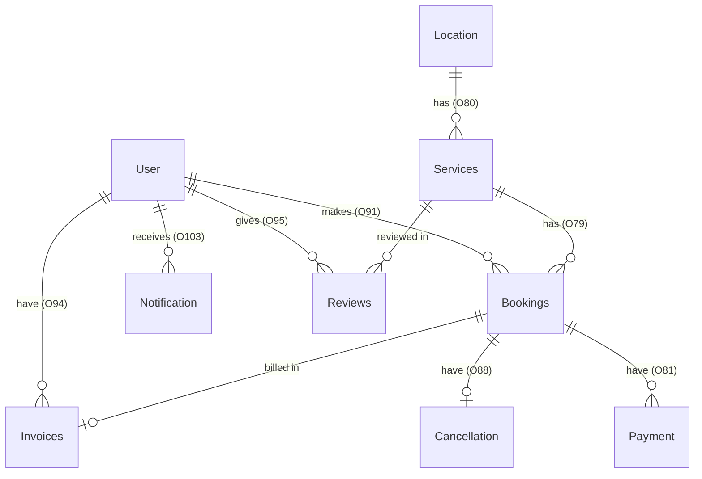

# Relational Database Design Specification

**Project:** Hotel Reservation System (RDBMS Lab & Theory Assignment)  
**Target DBMS:** MySQL 8.0 (InnoDB Storage Engine, `utf8mb4`)  
**Source ER Diagram:** [`Diagram1.dia`](file:///c:/Users/anany/OneDrive/Desktop/RDBMS%20project/Diagram1.dia)  
**SQL Implementation:** [`database/schema.sql`](file:///c:/Users/anany/OneDrive/Desktop/RDBMS%20project/database/schema.sql), [`database/seed.sql`](file:///c:/Users/anany/OneDrive/Desktop/RDBMS%20project/database/seed.sql), [`database/verification.sql`](file:///c:/Users/anany/OneDrive/Desktop/RDBMS%20project/database/verification.sql)

---

## 1. Overview & Provenance of the Schema

This relational database schema is derived directly from the original Chen-style Entity-Relationship diagram ([`Diagram1.dia`](file:///c:/Users/anany/OneDrive/Desktop/RDBMS%20project/Diagram1.dia)). All **9 original entities** and all **35 original attribute ellipses** drawn in `Diagram1.dia` are preserved verbatim—including their exact hyphenated identifier names (such as `` `U-ID` ``, `` `B-ID` ``, `` `S-ID` ``, `` `L-ID` ``, and `` `Refund-amt` ``).

In accordance with academic integrity and database engineering best practices, this document strictly separates:
1. **Elements originally present in `Diagram1.dia`**, and
2. **Approved relational additions** introduced during the ER inspection phase ([`docs/erd_analysis.md`](file:///c:/Users/anany/OneDrive/Desktop/RDBMS%20project/docs/erd_analysis.md)) where the original diagram omitted attributes (specifically on `Bookings`, which had zero attribute ellipses attached in the drawing, and `Services`, which required location linkage and inventory capacity to check room availability).

---

## 2. Relational Schema & Table Dictionary

### 2.1 Summary of Original vs. Approved Added Attributes

| Relation (Table) | Attributes Present in `Diagram1.dia` | Approved Attributes Added for Reservation & Availability | Primary Key | Foreign Keys |
| :--- | :--- | :--- | :--- | :--- |
| **`User`** | `U-ID`, `Name`, `Phone`, `Email` | *None* | `U-ID` | *None* |
| **`Location`** | `L-ID`, `Name`, `Address`, `City`, `Country` | *None* | `L-ID` | *None* |
| **`Services`** | `S-ID`, `Name`, `Price`, `Description` | `L-ID`, `Category`, `Max_Guests`, `Total_Units` | `S-ID` | `L-ID` $\rightarrow$ `Location(L-ID)` |
| **`Bookings`** | *(No attribute ellipses drawn in `Diagram1.dia`)* | `B-ID`, `U-ID`, `S-ID`, `Check_In`, `Check_Out`, `Guests`, `Status` | `B-ID` | `U-ID` $\rightarrow$ `User(U-ID)` `S-ID` $\rightarrow$ `Services(S-ID)` |
| **`Payment`** | `P-ID`, `B-ID`, `Amt`, `Date`, `Method` | *None* | `P-ID` | `B-ID` $\rightarrow$ `Bookings(B-ID)` |
| **`Cancellation`** | `C-ID`, `B-ID`, `Date`, `Refund-amt` | *None* | `C-ID` | `B-ID` $\rightarrow$ `Bookings(B-ID)` |
| **`Invoices`** | `I-ID`, `U-ID`, `B-ID`, `Amt`, `Date` | *None* | `I-ID` | `U-ID` $\rightarrow$ `User(U-ID)` `B-ID` $\rightarrow$ `Bookings(B-ID)` |
| **`Reviews`** | `R-ID`, `U-ID`, `S-ID`, `Rating`, `Comment` | *None* | `R-ID` | `U-ID` $\rightarrow$ `User(U-ID)` `S-ID` $\rightarrow$ `Services(S-ID)` |
| **`Notification`** | `N-ID`, `U-ID`, `Message` | *None* | `N-ID` | `U-ID` $\rightarrow$ `User(U-ID)` |

---

### 2.2 Detailed Table Definitions

#### 1. `User`
Stores registered customers/guests who make reservations, submit reviews, and receive notifications.
- **Primary Key:** `` `U-ID` `` (`INT AUTO_INCREMENT`)
- **Attributes:**
  - `` `Name` `` (`VARCHAR(100) NOT NULL`) — Guest's full name (`CHECK` enforces minimum length of 2 characters).
  - `` `Phone` `` (`VARCHAR(20) NOT NULL UNIQUE`) — Contact phone number; candidate key enforced via `UNIQUE`.
  - `` `Email` `` (`VARCHAR(150) NOT NULL UNIQUE`) — Email address; candidate key enforced via `UNIQUE` and basic format `CHECK`.

#### 2. `Location`
Stores physical hotel branches/properties where rooms and hotel services are offered.
- **Primary Key:** `` `L-ID` `` (`INT AUTO_INCREMENT`)
- **Attributes:**
  - `` `Name` `` (`VARCHAR(120) NOT NULL`) — Property name (e.g., *Grand Aurelia Palace Udaipur*).
  - `` `Address` `` (`VARCHAR(255) NOT NULL`) — Street address.
  - `` `City` `` (`VARCHAR(80) NOT NULL`) — City name.
  - `` `Country` `` (`VARCHAR(80) NOT NULL DEFAULT 'India'`) — Country name.

#### 3. `Services`
Represents bookable hotel offerings at a specific `Location`, supporting both **hotel rooms/suites** (`Category = 'Room'`) and **optional hotel add-ons** (`Category = 'Add-On'`, such as spa packages or airport transfers).
- **Primary Key:** `` `S-ID` `` (`INT AUTO_INCREMENT`)
- **Foreign Key:** `` `L-ID` `` references `` `Location`(`L-ID`) `` (`ON DELETE RESTRICT ON UPDATE CASCADE`) — Implements the `Services — has — Location` diamond (`O80`) from `Diagram1.dia`.
- **Original Attributes:**
  - `` `Name` `` (`VARCHAR(120) NOT NULL`)
  - `` `Price` `` (`DECIMAL(10, 2) NOT NULL`, `CHECK (Price > 0.00)`) — Exact fixed-point monetary representation.
  - `` `Description` `` (`TEXT NOT NULL`)
- **Approved Added Attributes:**
  - `` `Category` `` (`ENUM('Room', 'Add-On') NOT NULL DEFAULT 'Room'`)
  - `` `Max_Guests` `` (`INT NOT NULL DEFAULT 2`, `CHECK (Max_Guests >= 1)`) — Maximum occupancy per unit.
  - `` `Total_Units` `` (`INT NOT NULL DEFAULT 1`, `CHECK (Total_Units >= 1)`) — Total physical inventory of this room type or service at the hotel location.

#### 4. `Bookings`
Central transactional entity recording guest reservations. Although `Bookings` (`O3`) had no ellipses attached in `Diagram1.dia`, its primary key `B-ID` was referenced by `Payment`, `Cancellation`, and `Invoices`.
- **Primary Key:** `` `B-ID` `` (`INT AUTO_INCREMENT`)
- **Foreign Keys:**
  - `` `U-ID` `` references `` `User`(`U-ID`) `` (`ON DELETE RESTRICT ON UPDATE CASCADE`) — Implements `User — makes — Bookings` (`O91`).
  - `` `S-ID` `` references `` `Services`(`S-ID`) `` (`ON DELETE RESTRICT ON UPDATE CASCADE`) — Implements `Bookings — has — Services` (`O79`) as a `1:N` relationship (`Services` $1 \rightarrow N$ `Bookings`).
- **Approved Added Attributes:**
  - `` `Check_In` `` (`DATE NOT NULL`) — Reservation start date.
  - `` `Check_Out` `` (`DATE NOT NULL`) — Reservation end date (`CHECK (Check_Out > Check_In)` guarantees at least a 1-night/1-day stay).
  - `` `Guests` `` (`INT NOT NULL DEFAULT 1`, `CHECK (Guests >= 1)`) — Number of guests.
  - `` `Status` `` (`ENUM('Pending', 'Confirmed', 'Cancelled', 'Completed') NOT NULL DEFAULT 'Pending'`) — Lifecycle state of the reservation.

#### 5. `Payment`
Records monetary transactions settled against a booking.
- **Primary Key:** `` `P-ID` `` (`INT AUTO_INCREMENT`)
- **Foreign Key:** `` `B-ID` `` references `` `Bookings`(`B-ID`) `` (`ON DELETE RESTRICT ON UPDATE CASCADE`) — Implements `Bookings — have — Payment` (`O81`).
- **Original Attributes:**
  - `` `Amt` `` (`DECIMAL(10, 2) NOT NULL`, `CHECK (Amt > 0.00)`)
  - `` `Date` `` (`DATETIME NOT NULL DEFAULT CURRENT_TIMESTAMP`)
  - `` `Method` `` (`ENUM('Credit Card', 'Debit Card', 'UPI', 'Net Banking', 'Cash') NOT NULL`)

#### 6. `Cancellation`
Records cancellation events and refund amounts for cancelled reservations.
- **Primary Key:** `` `C-ID` `` (`INT AUTO_INCREMENT`)
- **Foreign Key:** `` `B-ID` `` references `` `Bookings`(`B-ID`) `` (`UNIQUE`, `ON DELETE RESTRICT ON UPDATE CASCADE`) — Implements `Cancellation — have — Bookings` (`O88`) as a `1 : 0..1` relationship (a booking can be cancelled at most once).
- **Original Attributes:**
  - `` `Date` `` (`DATETIME NOT NULL DEFAULT CURRENT_TIMESTAMP`)
  - `` `Refund-amt` `` (`DECIMAL(10, 2) NOT NULL DEFAULT 0.00`, `CHECK (\`Refund-amt\` >= 0.00)`)

#### 7. `Invoices`
Stores billing invoices generated for a user's booking.
- **Primary Key:** `` `I-ID` `` (`INT AUTO_INCREMENT`)
- **Foreign Keys:**
  - `` `U-ID` `` references `` `User`(`U-ID`) `` (`ON DELETE RESTRICT ON UPDATE CASCADE`) — Implements `User — have — Invoices` (`O94`).
  - `` `B-ID` `` references `` `Bookings`(`B-ID`) `` (`UNIQUE`, `ON DELETE RESTRICT ON UPDATE CASCADE`) — Enforces one invoice per booking.
- **Original Attributes:**
  - `` `Amt` `` (`DECIMAL(10, 2) NOT NULL`, `CHECK (Amt >= 0.00)`)
  - `` `Date` `` (`DATETIME NOT NULL DEFAULT CURRENT_TIMESTAMP`)

#### 8. `Reviews`
Stores guest ratings and textual feedback for specific rooms or services.
- **Primary Key:** `` `R-ID` `` (`INT AUTO_INCREMENT`)
- **Foreign Keys:**
  - `` `U-ID` `` references `` `User`(`U-ID`) `` (`ON DELETE CASCADE ON UPDATE CASCADE`) — Implements `User — gives — Reviews` (`O95`).
  - `` `S-ID` `` references `` `Services`(`S-ID`) `` (`ON DELETE CASCADE ON UPDATE CASCADE`) — Enforces referential integrity for the `S-ID` attribute drawn on `Reviews` in `Diagram1.dia`.
- **Original Attributes:**
  - `` `Rating` `` (`INT NOT NULL`, `CHECK (Rating BETWEEN 1 AND 5)`)
  - `` `Comment` `` (`TEXT NOT NULL`)

#### 9. `Notification`
Stores system alerts and reservation updates sent to users.
- **Primary Key:** `` `N-ID` `` (`INT AUTO_INCREMENT`)
- **Foreign Key:** `` `U-ID` `` references `` `User`(`U-ID`) `` (`ON DELETE CASCADE ON UPDATE CASCADE`) — Implements `User — receives — Notification` (`O103`).
- **Original Attributes:**
  - `` `Message` `` (`VARCHAR(500) NOT NULL`, `CHECK (CHAR_LENGTH(TRIM(Message)) > 0)`)

---

## 3. Relationships & Cardinalities

| Relationship | Parent ($1$) | Child ($N$ or $0..1$) | Cardinality | Referential Action (`ON DELETE`) |
| :--- | :--- | :--- | :--- | :--- |
| `User` — `Bookings` | `User` | `Bookings` | $1 : N$ | `RESTRICT` (preserve booking history) |
| `Location` — `Services` | `Location` | `Services` | $1 : N$ | `RESTRICT` (prevent deleting active hotel locations) |
| `Services` — `Bookings` | `Services` | `Bookings` | $1 : N$ | `RESTRICT` (prevent deleting booked rooms/services) |
| `Bookings` — `Payment` | `Bookings` | `Payment` | $1 : N$ | `RESTRICT` (preserve financial audit trail) |
| `Bookings` — `Cancellation` | `Bookings` | `Cancellation` | $1 : 0..1$ | `RESTRICT` (`UNIQUE` on `Cancellation.B-ID`) |
| `Bookings` — `Invoices` | `Bookings` | `Invoices` | $1 : 0..1$ | `RESTRICT` (`UNIQUE` on `Invoices.B-ID`) |
| `User` — `Reviews` | `User` | `Reviews` | $1 : N$ | `CASCADE` |
| `Services` — `Reviews` | `Services` | `Reviews` | $1 : N$ | `CASCADE` |
| `User` — `Notification` | `User` | `Notification` | $1 : N$ | `CASCADE` |

---

## 4. Normalization Analysis (1NF, 2NF, 3NF)

1. **First Normal Form (1NF):**
   - Every table has a primary key (`U-ID`, `L-ID`, `S-ID`, `B-ID`, `P-ID`, `C-ID`, `I-ID`, `R-ID`, `N-ID`).
   - All attributes contain strictly atomic values (no repeating groups, comma-separated lists, or nested arrays).

2. **Second Normal Form (2NF):**
   - All 9 tables use single-attribute surrogate primary keys (`*-ID`). Because no table relies on a composite primary key, **no partial functional dependencies can exist**. Every non-key attribute is fully functionally dependent on the entire primary key.

3. **Third Normal Form (3NF) & Resolution of the `User — makes — Payment` Cycle:**
   - In `Diagram1.dia`, `Payment` (`O6`) was connected both to `Bookings` via `have` (`O81`) and to `User` via `makes` (`O96`), while only `B-ID` was drawn as an attribute on `Payment`.
   - Since each booking belongs to a single user ($\text{B-ID} \rightarrow \text{U-ID}$), storing `U-ID` inside `Payment` would introduce a transitive dependency:
     $$\text{P-ID} \rightarrow \text{B-ID} \rightarrow \text{U-ID}$$
   - By keeping `Payment` with only its original diagram attributes (`P-ID`, `B-ID`, `Amt`, `Date`, `Method`) and resolving the paying user via `Bookings.U-ID`, `Payment` satisfies strict **Third Normal Form (3NF)** and **Boyce-Codd Normal Form (BCNF)**.
   - Similarly, hotel location details (`Address`, `City`, `Country`) are stored exclusively in `Location` and referenced by `Services` via `L-ID`, preventing update, insertion, and deletion anomalies.
   - *Note on `Invoices`*: `Invoices` retains both `U-ID` and `B-ID` exclusively to preserve the exact attribute ellipses drawn on `Invoices` (`O8`) in `Diagram1.dia`. Application logic ensures `Invoices.U-ID` always matches `Bookings.U-ID`.

---

## 5. Room Availability & Overlap Prevention Logic

To prevent double-booking and ensure that cancelled bookings do not block future reservations, availability for any service `S-ID` over a requested interval $[\text{Req\_In}, \text{Req\_Out})$ is evaluated using interval intersection logic:

$$\text{Overlap Exists} \iff (\text{Check\_In} < \text{Req\_Out}) \land (\text{Check\_Out} > \text{Req\_In}) \land (\text{Status} \in \{\text{'Pending'}, \text{'Confirmed'}\})$$

- **Why `Cancelled` Bookings Do Not Block Availability:** When a booking is cancelled, a record is inserted into `Cancellation` and `Bookings.Status` is updated to `'Cancelled'`. Because the availability query filters strictly for `Status IN ('Pending', 'Confirmed')`, cancelled reservations are ignored when counting occupied units.
- **Available Inventory Calculation:**
  $$\text{Available\_Units} = \text{Services.Total\_Units} - \text{COUNT}(\text{Active Overlapping Bookings})$$
  A new reservation is permitted if and only if $\text{Available\_Units} \ge 1$ and $\text{Requested\_Guests} \le \text{Services.Max\_Guests}$.

---

## 6. Indexing Strategy

| Index Name | Table & Columns | Justification |
| :--- | :--- | :--- |
| `idx_bookings_availability` | `Bookings (S-ID, Status, Check_In, Check_Out)` | **Covering index** for the room availability & date-overlap query, avoiding full table scans on `Bookings`. |
| `idx_bookings_user` | `Bookings (U-ID, Check_In)` | Accelerates the "My Bookings" customer dashboard sorted chronologically. |
| `idx_services_location_category` | `Services (L-ID, Category)` | Speeds up filtering rooms vs. add-on services at a specific hotel branch. |
| `idx_services_price` | `Services (Price)` | Optimizes price-range filtering and sorting in the room catalog. |
| `idx_location_city_country` | `Location (City, Country)` | Accelerates destination searches by city. |
| `idx_reviews_service_rating` | `Reviews (S-ID, Rating)` | Speeds up computing average ratings and loading reviews for a specific service. |
