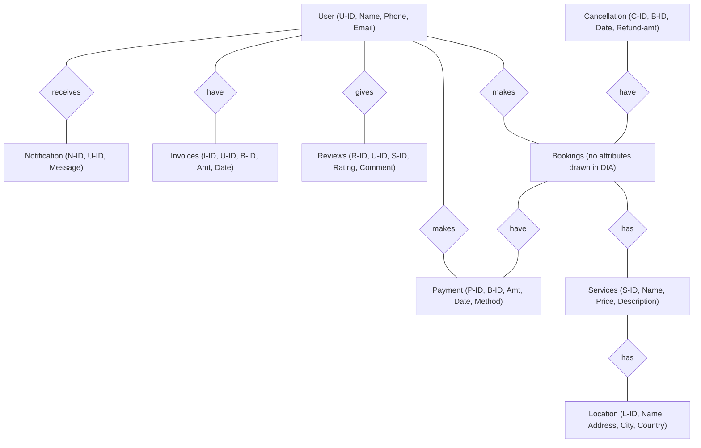

# ER Diagram Inspection & Database Design Analysis (`Diagram1.dia`)

## 1. Executive Summary

We inspected the actual [`Diagram1.dia`](file:///c:/Users/anany/OneDrive/Desktop/RDBMS%20project/Diagram1.dia) XML source file (106 DIA objects, `O0`–`O105`) alongside the exported diagram image.

The diagram uses **Chen-style ER notation** constructed with DIA Flowchart shapes:
- **Entities**: 9 `Flowchart - Box` objects (`O0`–`O8`)
- **Attributes**: 35 `Flowchart - Ellipse` objects connected to entities via directed lines (`end_arrow=22`)
- **Relationships**: 9 `Flowchart - Diamond` objects connected to entities via undirected lines (`start_arrow=None`, `end_arrow=None`)

> [!IMPORTANT]
> **Key Discovery in `Diagram1.dia`:**
> The **`Bookings`** entity (`O3`) is connected to four relationship diamonds (`makes`, `have` [Cancellation], `have` [Payment], `has` [Services]), and its primary key `B-ID` is referenced as a foreign key in **`Cancellation`**, **`Payment`**, and **`Invoices`**. However, **`Bookings` itself has zero attribute ellipses drawn on it in `Diagram1.dia`**—meaning `B-ID`, `U-ID`, `S-ID`, check-in/check-out dates, guest count, and booking status are currently missing from the `Bookings` entity in the diagram.

---

## 2. Extracted Schema (Strictly as Present in `Diagram1.dia`)

Nothing below has been renamed, removed, or assumed. Primary keys (PK) and foreign keys (FK) are identified from the explicit `*-ID` naming conventions used across the ellipses in `Diagram1.dia` (DIA Flowchart ellipses do not have underline formatting).

| Entity (DIA ID) | Exact Attributes in Diagram (DIA IDs) | Identifiable PK | Identifiable FKs in Diagram | Notes from `Diagram1.dia` |
| :--- | :--- | :--- | :--- | :--- |
| **`User`** (`O0`) | `U-ID` (`O60`), `Name` (`O59`), `Phone` (`O58`), `Email` (`O57`) | `U-ID` | *None* | Core customer/user entity. |
| **`Notification`** (`O1`) | `N-ID` (`O62`), `U-ID` (`O61`), `Message` (`O63`) | `N-ID` | `U-ID` $\rightarrow$ `User(U-ID)` | Stores messages sent to a specific user. |
| **`Cancellation`** (`O2`) | `C-ID` (`O71`), `B-ID` (`O72`), `Date` (`O73`), `Refund-amt` (`O74`) | `C-ID` | `B-ID` $\rightarrow$ `Bookings(B-ID)` | Tracks cancellation date and refund amount for a booking. |
| **`Bookings`** (`O3`) | *(No attribute ellipses attached in diagram)* | `B-ID` *(implied by FKs in `Cancellation`, `Payment`, `Invoices`)* | *(None drawn; `U-ID` and `S-ID` implied by `makes` and `has` diamonds)* | Central reservation entity, but its attribute ellipses were omitted in the drawing. |
| **`Services`** (`O4`) | `S-ID` (`O9`), `Name` (`O10`), `Price` (`O11`), `Description` (`O12`) | `S-ID` | *(None drawn; relationship `has` connects `Services` and `Location`)* | The only bookable/reviewable catalog entity linked to `Bookings`, `Reviews`, and `Location`. |
| **`Location`** (`O5`) | `L-ID` (`O20`), `Name` (`O21`), `Address` (`O19`), `City` (`O17`), `Country` (`O18`) | `L-ID` | *(None drawn)* | Represents physical hotel property/branch location. |
| **`Payment`** (`O6`) | `P-ID` (`O27`), `B-ID` (`O29`), `Amt` (`O28`), `Date` (`O30`), `Method` (`O31`) | `P-ID` | `B-ID` $\rightarrow$ `Bookings(B-ID)` | Connected to both `Bookings` (`have`) and `User` (`makes`). |
| **`Reviews`** (`O7`) | `R-ID` (`O37`), `U-ID` (`O38`), `S-ID` (`O39`), `Rating` (`O40`), `Comment` (`O41`) | `R-ID` | `U-ID` $\rightarrow$ `User(U-ID)` `S-ID` $\rightarrow$ `Services(S-ID)` | Links a user's rating and comment to a specific `S-ID` (`Services`). |
| **`Invoices`** (`O8`) | `I-ID` (`O49`), `U-ID` (`O47`), `B-ID` (`O48`), `Amt` (`O50`), `Date` (`O51`) | `I-ID` | `U-ID` $\rightarrow$ `User(U-ID)` `B-ID` $\rightarrow$ `Bookings(B-ID)` | Connected to `User` via `have`, and holds `B-ID` referencing `Bookings`. |

---

## 3. Relationship & Cardinality Analysis

In `Diagram1.dia`, all 9 relationship diamonds (`O79`–`O81`, `O88`, `O91`, `O94`–`O96`, `O103`) are connected to their respective entity boxes using plain undirected lines (`start_arrow=None`, `end_arrow=None`) without text labels (`1`, `N`, `M`) on the lines.

Below is what can be **confidently deduced from explicit Foreign Key placement** versus what remains **ambiguous** in the diagram:

| Relationship Diamond (DIA ID) | Connected Entities | Explicit FK in Diagram? | Cardinality Status in Diagram | Analysis |
| :--- | :--- | :--- | :--- | :--- |
| **`receives`** (`O103`) | `User` (`O0`) — `Notification` (`O1`) | Yes: `Notification.U-ID` | **Implied `1 : N`** (`User` to `Notification`) | Since `Notification` holds `U-ID`, each notification belongs to one `User`, and a `User` can receive multiple notifications. |
| **`makes`** (`O91`) | `User` (`O0`) — `Bookings` (`O3`) | No (`Bookings` has no ellipses) | **Unmarked in diagram** (Standard domain: `1 : N`) | A user makes bookings. Because `Bookings` has no attributes drawn, `U-ID` is not explicitly shown on `Bookings`, though `Invoices` has both `U-ID` and `B-ID`. |
| **`have`** (`O94`) | `User` (`O0`) — `Invoices` (`O8`) | Yes: `Invoices.U-ID` (and `Invoices.B-ID`) | **Implied `1 : N`** (`User` to `Invoices`) | `Invoices` contains `U-ID` and `B-ID`. Notice there is no diamond directly between `Bookings` and `Invoices`, even though `Invoices` carries `B-ID`. |
| **`gives`** (`O95`) | `User` (`O0`) — `Reviews` (`O7`) | Yes: `Reviews.U-ID` (and `Reviews.S-ID`) | **Implied `1 : N`** (`User` to `Reviews`) | `Reviews` carries both `U-ID` and `S-ID`. Interestingly, there is no diamond drawn between `Reviews` and `Services`, even though `Reviews` explicitly contains `S-ID`. |
| **`makes`** (`O96`) | `User` (`O0`) — `Payment` (`O6`) | No (`Payment` has `B-ID`, not `U-ID`) | **Unmarked / Redundant path?** | `Payment` connects to `User` via `makes` (`O96`) and to `Bookings` via `have` (`O81`), creating a cycle (`User` — `Bookings` — `Payment` — `User`). `Payment` only has `B-ID` (not `U-ID`). |
| **`have`** (`O88`) | `Bookings` (`O3`) — `Cancellation` (`O2`) | Yes: `Cancellation.B-ID` | **Implied `1 : 0..1` or `1 : N`** | `Cancellation` holds `B-ID`. Usually a booking can be cancelled once (`1 : 0..1` with `UNIQUE(B-ID)`), or multiple times if partial/room-level cancellations are allowed. |
| **`have`** (`O81`) | `Bookings` (`O3`) — `Payment` (`O6`) | Yes: `Payment.B-ID` | **Implied `1 : 1` or `1 : N`** | `Payment` holds `B-ID`. Could be `1:1` (single payment per booking) or `1:N` (split payments, deposits, or failed + retry attempts). |
| **`has`** (`O79`) | `Bookings` (`O3`) — `Services` (`O4`) | No | **Ambiguous (`1:N` vs `M:N`)** | Does one `Bookings` record book a single `Services` item (`Bookings.S-ID`), or can one booking include multiple rooms/services (`M:N` junction table)? |
| **`has`** (`O80`) | `Services` (`O4`) — `Location` (`O5`) | No (`L-ID` is only on `Location`) | **Ambiguous direction (`N:1` vs `1:N` vs `M:N`)** | In a hotel chain/multi-property system, one `Location` (hotel branch) has many `Services` (rooms/amenities), so `Services` would carry `L-ID` (`N:1`). |

### Diagram as Extracted (Mermaid Representation)

---

## 4. Deep-Dive on Specific Requirements

### 4.1 What Does `Services` Represent? (Rooms vs. Add-on Services vs. Both)
In `Diagram1.dia`, there is **no separate `Room` or `Hotel` entity**. Instead:
1. `Bookings` connects **only** to `Services` (via `has`, `O79`).
2. `Services` connects to `Location` (via `has`, `O80`), which has `L-ID`, `Name`, `Address`, `City`, `Country`.
3. `Reviews` references `S-ID` (`Services`), meaning users review `Services`.
4. `Services` has `S-ID`, `Name`, `Price`, `Description`.

**Conclusion:**
In your ER diagram, **`Services` is the primary bookable accommodation/offering entity** (representing bookable hotel rooms/suites at a given `Location`, or potentially both bookable rooms and add-on hotel services like Spa/Airport Pickup/Breakfast).
- If `Services` represents **bookable rooms/room types** (or both rooms and add-on services differentiated by a category/type attribute), we must keep the entity name `Services` (`S-ID`, `Name`, `Price`, `Description`) so your ER diagram remains 100% intact, while adding room-specific attributes (such as `Service_Type` / `Room_Number` / `Capacity` / `Total_Inventory` / `L-ID`).

### 4.2 Inspection of `Bookings` Attributes
Checking `Bookings` (`O3`) against reservation requirements:
- **Primary Key (`B-ID`)**: Missing on `Bookings` in the diagram (though proven to exist because `Payment.B-ID`, `Cancellation.B-ID`, and `Invoices.B-ID` reference it).
- **Foreign Keys (`U-ID`, `S-ID`)**: Missing on `Bookings` in the diagram.
- **Check-in and Check-out Dates**: **Missing** in the diagram.
- **Guest Count**: **Missing** in the diagram.
- **Booking Status** (e.g., `Pending`, `Confirmed`, `Cancelled`, `Checked-In`, `Completed`): **Missing** in the diagram.
- **Booking Creation Date / Total Amount**: **Missing** on `Bookings` (though `Amt` and `Date` exist on `Payment` and `Invoices`).

### 4.3 Missing Information Required for Room Availability & Preventing Overlapping Reservations
To check room availability for a requested date range `[Check_In, Check_Out)` and prevent double-booking / overlapping reservations, the database is currently missing:

1. **Temporal bounds on `Bookings`**:
   - `Check_In_Date` (`DATE` or `TIMESTAMP`) and `Check_Out_Date` (`DATE` or `TIMESTAMP`), with a constraint `Check_Out_Date > Check_In_Date`.
2. **Active status tracking on `Bookings`**:
   - `Status` (so cancelled bookings do not block availability for future guests).
3. **Capacity & Inventory definition on `Services`**:
   - `Max_Guests` / `Capacity` (to validate against `Bookings.Guest_Count`).
   - Either:
     - **Option A (Individual Room Units)**: Each row in `Services` (or a child unit identifier) has a specific room/unit or `Total_Rooms` count, allowing overlap checks via:
       $$\text{Existing}_{\text{Check\_In}} < \text{New}_{\text{Check\_Out}} \quad \text{AND} \quad \text{Existing}_{\text{Check\_Out}} > \text{New}_{\text{Check\_In}}$$
     - **Option B (Room Type Inventory + Quantity)**: `Services` has `Total_Units` (e.g., 5 Deluxe Rooms at a `Location`) and `Bookings` tracks `Units_Booked` (or specific room assignment), preventing bookings when overlapping active reservations reach `Total_Units`.
4. **Location Linkage (`L-ID` in `Services`)**:
   - `Services` needs `L-ID` as an explicit Foreign Key referencing `Location(L-ID)` so users can search availability by `City`, `Country`, or hotel `Location.Name`.

---

## 5. Separation of Original Diagram vs. Proposed Additions & Corrections

To strictly respect your rules, we separate **what is already in `Diagram1.dia`** from **proposed additions** that preserve every single existing entity and attribute name.

### 5.1 Already Present in `Diagram1.dia` (Preserved Verbatim)
- **Entities (9)**: `User`, `Notification`, `Cancellation`, `Bookings`, `Services`, `Location`, `Payment`, `Reviews`, `Invoices`
- **Existing Attributes (35)**:
  - `User`: `U-ID`, `Name`, `Phone`, `Email`
  - `Notification`: `N-ID`, `U-ID`, `Message`
  - `Cancellation`: `C-ID`, `B-ID`, `Date`, `Refund-amt`
  - `Bookings`: *(none drawn in diagram; `B-ID` referenced by other entities)*
  - `Services`: `S-ID`, `Name`, `Price`, `Description`
  - `Location`: `L-ID`, `Name`, `Address`, `City`, `Country`
  - `Payment`: `P-ID`, `B-ID`, `Amt`, `Date`, `Method`
  - `Reviews`: `R-ID`, `U-ID`, `S-ID`, `Rating`, `Comment`
  - `Invoices`: `I-ID`, `U-ID`, `B-ID`, `Amt`, `Date`

### 5.2 Proposed Additions & Refinements (For Your Approval)

| Entity | Existing Attributes (Kept Exact) | Proposed Added Attributes | Purpose of Addition |
| :--- | :--- | :--- | :--- |
| **`User`** | `U-ID`, `Name`, `Phone`, `Email` | `Password_Hash` (or `Role`, `Created_At`) | Authentication (Customer vs. Admin) for a complete full-stack system. |
| **`Bookings`** | *(None in diagram)* | `B-ID` (PK), `U-ID` (FK), `S-ID` (FK), `Check_In`, `Check_Out`, `Guests`, `Status`, `Total_Amt`, `Booking_Date` | Completes the blank `Bookings` entity so reservations, availability checks, and overlap prevention work. |
| **`Services`** | `S-ID`, `Name`, `Price`, `Description` | `L-ID` (FK $\rightarrow$ `Location`), `Category` (`Room` vs `Add-On`), `Max_Guests`, `Total_Units` (or `Room_Number`), `Image_URL` | Links rooms/services to a hotel `Location`, enforces guest capacity, and enables availability/overlap queries. |
| **`Location`** | `L-ID`, `Name`, `Address`, `City`, `Country` | *(Optional)* `Rating_Avg`, `Image_URL` | Enhances hotel property browsing while keeping all 5 original attributes. |
| **`Payment`** | `P-ID`, `B-ID`, `Amt`, `Date`, `Method` | `Status` (`Pending`, `Completed`, `Failed`, `Refunded`), `U-ID` *(optional, if direct `User-makes-Payment` FK is desired)* | Tracks payment state and aligns with the `User — makes — Payment` diamond if needed. |
| **`Cancellation`** | `C-ID`, `B-ID`, `Date`, `Refund-amt` | `Reason` *(optional)* | Useful for cancellation logs; all 4 original attributes preserved. |
| **`Invoices`** | `I-ID`, `U-ID`, `B-ID`, `Amt`, `Date` | `Tax_Amt` / `Status` *(optional)* | All 5 original attributes already sufficient for core invoicing. |
| **`Reviews`** | `R-ID`, `U-ID`, `S-ID`, `Rating`, `Comment` | `Review_Date` *(optional)* | Shows when a review was posted; all 5 original attributes preserved. |
| **`Notification`** | `N-ID`, `U-ID`, `Message` | `Created_At`, `Is_Read` *(optional)* | Allows unread badge and chronological sorting in the UI. |

### 5.3 Missing Diagram Links to Clarify
1. **`Reviews` $\leftrightarrow$ `Services`**: `Reviews` has the attribute `S-ID` (`O39`), but no diamond line connects `Reviews` to `Services` in `Diagram1.dia`. We should enforce the FK `Reviews.S-ID -> Services.S-ID`.
2. **`Invoices` $\leftrightarrow$ `Bookings`**: `Invoices` has the attribute `B-ID` (`O48`), but only connects to `User` in the drawing. We should enforce both FKs: `Invoices.U-ID -> User.U-ID` and `Invoices.B-ID -> Bookings.B-ID`.
3. **`User` $\leftrightarrow$ `Payment`**: `User` connects to `Payment` via `makes` (`O96`), and `Bookings` connects to `Payment` via `have` (`O81`). In `Payment`, only `B-ID` is drawn. Should `Payment` also store `U-ID` directly, or resolve the user through `Bookings.U-ID`?

---

## 6. Confirmed Design Decisions (Resolved)

Based on your confirmation, the following design decisions are locked in for the relational schema:

1. **Role of `Services`**:
   - **`Services`** represents **both bookable hotel rooms/suites and optional add-on hotel services** (such as Spa, Breakfast, Airport Pickup), differentiated by a `Category` column (e.g., `'Room'` vs. `'Add-On'`), while preserving all original attributes (`S-ID`, `Name`, `Price`, `Description`) and linking to `Location` via `L-ID`.
2. **`Bookings` $\leftrightarrow$ `Services` Cardinality (`has`, `O79`)**:
   - Modeled as **1-to-Many (`1:N`)** (`Services` $1 \rightarrow N$ `Bookings`) by storing `S-ID` directly on `Bookings`. This keeps the exact 9-table structure from `Diagram1.dia` without extra junction tables.
3. **Finalized Attributes on `Bookings`**:
   - Since `Bookings` had no attribute ellipses in `Diagram1.dia`, it is defined with the minimal required reservation attributes:
     - `B-ID` (Primary Key)
     - `U-ID` (Foreign Key $\rightarrow$ `User.U-ID`)
     - `S-ID` (Foreign Key $\rightarrow$ `Services.S-ID`)
     - `Check_In` (`DATE`)
     - `Check_Out` (`DATE`)
     - `Guests` (`INT`)
     - `Status` (`VARCHAR` — e.g., `'Pending'`, `'Confirmed'`, `'Cancelled'`, `'Completed'`)
4. **`User` — `makes` — `Payment` Relationship (`O96`)**:
   - Kept in **3NF**: `Payment` retains its exact drawn attributes (`P-ID`, `B-ID`, `Amt`, `Date`, `Method`) and resolves the paying `User` through `Bookings.U-ID` without duplicating `U-ID` on `Payment`.

---

## 7. Final 9-Table Relational Schema Overview (Original vs. Added Columns)

| Table Name | Original Attributes from `Diagram1.dia` | Added Attributes for Functional Reservation & Availability | Primary Key | Foreign Keys |
| :--- | :--- | :--- | :--- | :--- |
| **`User`** | `U-ID`, `Name`, `Phone`, `Email` | *(Optional auth/role if required in later prompts)* | `U-ID` | — |
| **`Location`** | `L-ID`, `Name`, `Address`, `City`, `Country` | — | `L-ID` | — |
| **`Services`** | `S-ID`, `Name`, `Price`, `Description` | `L-ID`, `Category` (`Room`/`Add-On`), `Max_Guests`, `Total_Units` | `S-ID` | `L-ID` $\rightarrow$ `Location(L-ID)` |
| **`Bookings`** | *(None drawn in diagram)* | `B-ID`, `U-ID`, `S-ID`, `Check_In`, `Check_Out`, `Guests`, `Status` | `B-ID` | `U-ID` $\rightarrow$ `User(U-ID)` `S-ID` $\rightarrow$ `Services(S-ID)` |
| **`Payment`** | `P-ID`, `B-ID`, `Amt`, `Date`, `Method` | — | `P-ID` | `B-ID` $\rightarrow$ `Bookings(B-ID)` |
| **`Cancellation`** | `C-ID`, `B-ID`, `Date`, `Refund-amt` | — | `C-ID` | `B-ID` $\rightarrow$ `Bookings(B-ID)` |
| **`Invoices`** | `I-ID`, `U-ID`, `B-ID`, `Amt`, `Date` | — | `I-ID` | `U-ID` $\rightarrow$ `User(U-ID)` `B-ID` $\rightarrow$ `Bookings(B-ID)` |
| **`Reviews`** | `R-ID`, `U-ID`, `S-ID`, `Rating`, `Comment` | — | `R-ID` | `U-ID` $\rightarrow$ `User(U-ID)` `S-ID` $\rightarrow$ `Services(S-ID)` |
| **`Notification`** | `N-ID`, `U-ID`, `Message` | — | `N-ID` | `U-ID` $\rightarrow$ `User(U-ID)` |

